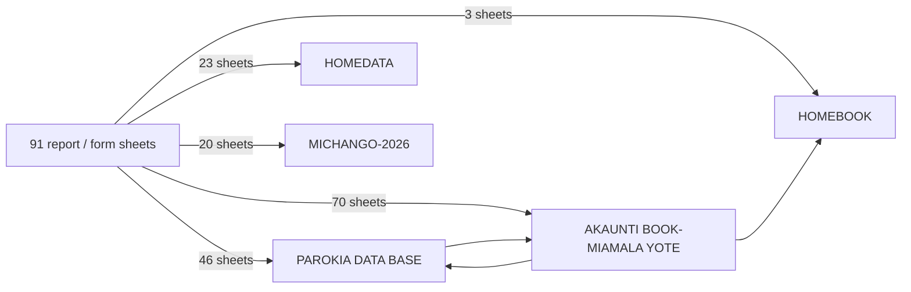

# Worksheet dependencies

_Generated from cross-sheet references found in formulas._

Arrows read "sheet → sheets it reads from". `REF` means a reference that Excel already shows as `#REF!` (the target was deleted).

| Sheet | Reads from |
|---|---|
| AKAUNTI BOOK-MIAMALA YOTE | HOMEBOOK (19,697), MAVUNO -2025 (2) (4), VIONGOZI JMY UJENZI (4), PAROKIA DATA BASE (1) |
| MIAMALA-YOTE | AKAUNTI BOOK-MIAMALA YOTE (63,972), HOMEBOOK (12) |
| PAROKIA DATA BASE | REF (100), AKAUNTI BOOK-MIAMALA YOTE (9) |
| PAROKIANI -MAVUNO&UJENZI | PAROKIA DATA BASE (290), HOMEDATA (7), AKAUNTI BOOK-MIAMALA YOTE (6), REF (4) |
| PAROKIANI -VIONGOZI | PAROKIA DATA BASE (2,475), REF (4), AKAUNTI BOOK-MIAMALA YOTE (3) |
| PAR ZAKA-UJENZI&MAVUNO-2026 -SI | PAROKIA DATA BASE (996), HOMEDATA (259), AKAUNTI BOOK-MIAMALA YOTE (85), MICHANGO-2026  (8) |
| RIPORT YA MAV & UJENZI-2026 FAM | PAROKIA DATA BASE (352), AKAUNTI BOOK-MIAMALA YOTE (64) |
| MAFRATERI -2026 NA BABA ASKOF | AKAUNTI BOOK-MIAMALA YOTE (152), MICHANGO-2026  (60), PAROKIA DATA BASE (46), REF (10) |
| MAKATEKISTA-&KONGAMANO | AKAUNTI BOOK-MIAMALA YOTE (156), MICHANGO-2026  (64), PAROKIA DATA BASE (46), REF (10) |
| MAPADRI & KRISTO MFUFUKA | AKAUNTI BOOK-MIAMALA YOTE (156), MICHANGO-2026  (64), PAROKIA DATA BASE (46), REF (10) |
| RADIO MARIA &VIWAWA | AKAUNTI BOOK-MIAMALA YOTE (156), MICHANGO-2026  (64), PAROKIA DATA BASE (46), REF (10) |
| Vig-ZAKA-UJENZI&MAVUNO-2026 (3) | PAROKIA DATA BASE (208), HOMEDATA (7) |
| Vig-TAARIFA YA KIGANGO | AKAUNTI BOOK-MIAMALA YOTE (16), PAROKIA DATA BASE (8), RIPORT YA MAV & UJENZI-2026 (6), MICHANGO-2026  (5) |
| RIPORT-YA-ZAKA-2026 - TATH | AKAUNTI BOOK-MIAMALA YOTE (495) |
| REPT-JUMUIYA nzima | PAROKIA DATA BASE (606), AKAUNTI BOOK-MIAMALA YOTE (471), MICHANGO-2026  (196) |
| REPORT -VIONGOZI | PAROKIA DATA BASE (400), HOMEDATA (56) |
| PAR ZAKA-UJENZI&MAVUNO-2026.. | PAROKIA DATA BASE (5,332), AKAUNTI BOOK-MIAMALA YOTE (84), MICHANGO-2026  (8), HOMEDATA (7), REF (2) |
| RIPORT YA MAV & UJENZI-2026 | PAROKIA DATA BASE (352), AKAUNTI BOOK-MIAMALA YOTE (72), REF (5) |
| FOMU-ZAKA-JMY NZIMA | PAROKIA DATA BASE (1,778), HOMEDATA (7), REF (1) |
| SMS ZAKA ,UJ & MAV | HOMEDATA (9,254), PAROKIA DATA BASE (9,225), REF (41) |
| RIPORT YA MAV & UJENZI-2026 (2) | PAROKIA DATA BASE (352), AKAUNTI BOOK-MIAMALA YOTE (64) |
| KONGAMANO MAKA | AKAUNTI BOOK-MIAMALA YOTE (7) |
| VIWAWA- | AKAUNTI BOOK-MIAMALA YOTE (66), MICHANGO-2026  (32), PAROKIA DATA BASE (17) |
| Vig-ZAKA-UJENZI&MAVUNO-2026 | PAROKIA DATA BASE (216), AKAUNTI BOOK-MIAMALA YOTE (14), HOMEDATA (7), RIPORT YA MAV & UJENZI-2026 (6), MICHANGO-2026  (5) |
| FOMU MAVU NA UJE | PAROKIA DATA BASE (78), HOMEDATA (7) |
| KUSOMESHA MAFRATERI | AKAUNTI BOOK-MIAMALA YOTE (78), MICHANGO-2026  (32), PAROKIA DATA BASE (23), REF (1) |
| FOMU ZAKA | PAROKIA DATA BASE (1,588), HOMEDATA (839) |
| MIAMALA-YOTE -SORTING (2) | AKAUNTI BOOK-MIAMALA YOTE (78,067), HOMEBOOK (15) |
| ZAWDI BABA ASKOFU | AKAUNTI BOOK-MIAMALA YOTE (78), MICHANGO-2026  (32), PAROKIA DATA BASE (23), REF (1) |
| PAR ZAKA-UJENZI&MAVUNO-25 & 26 | PAROKIA DATA BASE (135,554), AKAUNTI BOOK-MIAMALA YOTE (2,290), HOMEDATA (203), MICHANGO-2026  (201) |
| VIGAN-UJE,&MAV REPORT | PAROKIA DATA BASE (228), AKAUNTI BOOK-MIAMALA YOTE (43), HOMEDATA (7), RIPORT YA MAV & UJENZI-2026 (6), MICHANGO-2026  (5) |
| WALIOONGOZ MAVUNO 2025 | PAROKIA DATA BASE (7,632), HOMEDATA (7) |
| WALIOONGOZ MAVUNO 202 DATA | PAROKIA DATA BASE (2,176) |
| VIGANGON-MAVUNO&UJENZI | PAROKIA DATA BASE (285), HOMEDATA (7) |
| FOMU-UKUSANYAJI ZAKA | PAROKIA DATA BASE (310), HOMEDATA (7) |
| ZAKA me-UJENZI&MAVUNO-2026 | PAROKIA DATA BASE (3,550), AKAUNTI BOOK-MIAMALA YOTE (2,432), HOMEDATA (1,258), MICHANGO-2026  (160) |
| MEMO | PAROKIA DATA BASE (2,313), HOMEDATA (1,542) |
| REPORT-FAMILIA | PAROKIA DATA BASE (198), HOMEDATA (7) |
| PAROKIANI-MAVUNO&UJENZI | PAROKIA DATA BASE (520), HOMEDATA (7), AKAUNTI BOOK-MIAMALA YOTE (6) |
| FREE-FOMU-ZAKA JMY NZIMA | REF (1) |
| FOMU -MAVU ,UJE & ZAKA-2026 | PAROKIA DATA BASE (528), HOMEDATA (7) |
| FOMU-UKUSANYAJI-MAV&UJE-JMY | PAROKIA DATA BASE (300), REF (2), HOMEDATA (1) |
| UTOAJI MTOTO NA MFUFUKA YESU | PAROKIA DATA BASE (1,442), HOMEDATA (289) |
| BAHASHA- | REF (30) |
| REPOTI-MTOTO YESU & MFUFUKA | PAROKIA DATA BASE (258), REF (4), HOMEDATA (1) |
| REPT-JUMUIYA-PAROKIAN MUGH-2026 | AKAUNTI BOOK-MIAMALA YOTE (16), PAROKIA DATA BASE (8), MICHANGO-2026  (4) |
| REPT-JUMUIYA-PAROKIAN MING 2026 | AKAUNTI BOOK-MIAMALA YOTE (480) |
| REPORT-VGANG VIGANGONI-2026 | AKAUNTI BOOK-MIAMALA YOTE (95), VIONGOZI JMY UJENZI (1) |
| REPORT JUMUIYA-PAROKIAN (2) | AKAUNTI BOOK-MIAMALA YOTE (69), REF (1) |
| REPORT VGANG VIGANGONI (3) | AKAUNTI BOOK-MIAMALA YOTE (40) |
| KRISTO-MFUFUKA-2026 | AKAUNTI BOOK-MIAMALA YOTE (78), MICHANGO-2026  (32), PAROKIA DATA BASE (23), REF (1) |
| MAKATEKISTA-2026 | AKAUNTI BOOK-MIAMALA YOTE (78), MICHANGO-2026  (32), PAROKIA DATA BASE (23), REF (1) |
| UTOTO-KONGAMANO-2026 (2) | AKAUNTI BOOK-MIAMALA YOTE (78), MICHANGO-2026  (32), PAROKIA DATA BASE (23), REF (1) |
| RIPORT YA ZAKA  2025 | AKAUNTI BOOK-MIAMALA YOTE (270) |
| RIPORT YA MAVUNO-2026 | PAROKIA DATA BASE (204), AKAUNTI BOOK-MIAMALA YOTE (55) |
| RIPORT-YA-ZAKA-2026 | AKAUNTI BOOK-MIAMALA YOTE (147), PAROKIA DATA BASE (79) |
| RIPORT-YA-ZAKA-2026 COMBINED | AKAUNTI BOOK-MIAMALA YOTE (464), PAROKIA DATA BASE (260) |
| RIPORT YA UJENZI-2026 | PAROKIA DATA BASE (204), AKAUNTI BOOK-MIAMALA YOTE (55) |
| REPPORT-MICHANGO-2026 | MICHANGO-2026  (127), AKAUNTI BOOK-MIAMALA YOTE (127) |
| MAVUNO &  UJE -2026 | PAROKIA DATA BASE (102), AKAUNTI BOOK-MIAMALA YOTE (29) |
| RIPORT YA MTOTO YESU | AKAUNTI BOOK-MIAMALA YOTE (52) |
| MAKATEKITSA | AKAUNTI BOOK-MIAMALA YOTE (214) |
| RIPORT MCHANGO UTOTO | AKAUNTI BOOK-MIAMALA YOTE (21) |
| REPORT JUMUIYA-PAROKIAN | AKAUNTI BOOK-MIAMALA YOTE (69), REF (1) |
| REPORT VGANG VIGANGONI | AKAUNTI BOOK-MIAMALA YOTE (40) |
| MADENI YOTE | REPT JUMUIYA-PAROKIAN MINGA  (64), REPT JUMUIYA-PAROKIAN MUGH (44), REPORT VGANG VIGANGONI (2) (16) |
| JUMLA MING & MUGHANGA | AKAUNTI BOOK-MIAMALA YOTE (1,700) |
| VIONGOZI JMY UJENZI | AKAUNTI BOOK-MIAMALA YOTE (112) |
| KUPONGEZA MAPADRI | AKAUNTI BOOK-MIAMALA YOTE (74), REF (31) |
| MAVUNO -2025 | AKAUNTI BOOK-MIAMALA YOTE (93) |
| MAVUNO -2025 (2) | AKAUNTI BOOK-MIAMALA YOTE (62) |
| MAVUNO -2025 (3) | AKAUNTI BOOK-MIAMALA YOTE (93) |
| REPORT MINGA & MUGH | JUMLA MING & MUGHANGA (72) |
| REPORT JMY VIJN | AKAUNTI BOOK-MIAMALA YOTE (27) |
| UJENZI-2025 (2) | AKAUNTI BOOK-MIAMALA YOTE (270) |
| REPT JUMUIYA-PAROKIAN MUGH | AKAUNTI BOOK-MIAMALA YOTE (330) |
| REPT JUMUIYA-PAROKIAN MINGA | AKAUNTI BOOK-MIAMALA YOTE (480) |
| REPORT VGANG VIGANGONI (2) | AKAUNTI BOOK-MIAMALA YOTE (95), VIONGOZI JMY UJENZI (1) |
| RISITI | HOMEBOOK (56), MIAMALA-YOTE   (36) |
| UJENZI-2025 | AKAUNTI BOOK-MIAMALA YOTE (234) |
| MCHANGO WABATIZWA | AKAUNTI BOOK-MIAMALA YOTE (57), UJENZI-2025 (21) |
| ZAWADI MAKATEKISTA | AKAUNTI BOOK-MIAMALA YOTE (70), REF (27) |
| FR MONKO NA JUBILEI | AKAUNTI BOOK-MIAMALA YOTE (82), REF (31) |
| ZAWADI ASKOFU | REF (31), AKAUNTI BOOK-MIAMALA YOTE (31) |
| MADENI- MAVUNO | AKAUNTI BOOK-MIAMALA YOTE (108) |
| ZAWADI KRISTO MFUFUKA | AKAUNTI BOOK-MIAMALA YOTE (151) |
| KONGAMANO | AKAUNTI BOOK-MIAMALA YOTE (23), REF (1) |
| REPORT MARIATHONI | AKAUNTI BOOK-MIAMALA YOTE (31) |
| BAHASHA RADI MARIA | AKAUNTI BOOK-MIAMALA YOTE (8) |
| BAHASHA RADI0 -2025 | REF (16), AKAUNTI BOOK-MIAMALA YOTE (8) |
| KAPU LA MAMA | AKAUNTI BOOK-MIAMALA YOTE (8) |
| BAHASHA KAPU LA MAMA | REF (16), AKAUNTI BOOK-MIAMALA YOTE (8) |
| ZAWADI ALOYCE GONZAGA | AKAUNTI BOOK-MIAMALA YOTE (20) |

**Sheets with broken (`#REF!`) references:** 29 — PAROKIA DATA BASE, PAROKIANI -MAVUNO&UJENZI, PAROKIANI -VIONGOZI, MAFRATERI -2026 NA BABA ASKOF, MAKATEKISTA-&KONGAMANO, MAPADRI & KRISTO MFUFUKA, RADIO MARIA &VIWAWA, PAR ZAKA-UJENZI&MAVUNO-2026.., RIPORT YA MAV & UJENZI-2026, FOMU-ZAKA-JMY NZIMA, SMS ZAKA ,UJ & MAV, KUSOMESHA MAFRATERI, ZAWDI BABA ASKOFU, FREE-FOMU-ZAKA JMY NZIMA, FOMU-UKUSANYAJI-MAV&UJE-JMY, BAHASHA-, REPOTI-MTOTO YESU & MFUFUKA, REPORT JUMUIYA-PAROKIAN (2), KRISTO-MFUFUKA-2026, MAKATEKISTA-2026, UTOTO-KONGAMANO-2026 (2), REPORT JUMUIYA-PAROKIAN, KUPONGEZA MAPADRI, ZAWADI MAKATEKISTA, FR MONKO NA JUBILEI, ZAWADI ASKOFU, KONGAMANO, BAHASHA RADI0 -2025, BAHASHA KAPU LA MAMA

**Defined names** map jumuiya blocks: 33 on the ledger (e.g. `CLARA_` = rows 750–1667) and 51 on the register (e.g. `CLARA` = rows 2758–2856). The importer uses these names, not row guesses — see `tools/migration/mapping.json`.